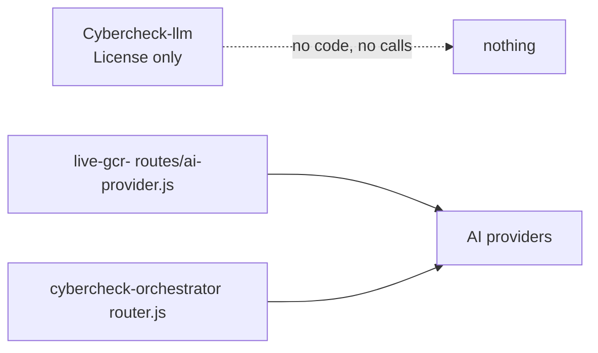

# Cybercheck-llm

An empty placeholder repository: it holds a one-line license file and no code.

## What it is

A repo that was created with a single `License` file whose entire content is the words "gulf coast radar cybercheck". The name suggests it was meant for a CyberCheck language-model or AI project, but nothing of that kind is here.

## How it works

- The repo has one tracked file, `License` (plus this README), on one branch (`main`).
- There is no source code, `package.json`, configuration or data, so there is nothing to call and nothing that calls it.
- The real AI code for the platform lives elsewhere: `live-gcr-/routes/ai-provider.js` (switches between Anthropic, OpenAI, Gemini, xAI, Groq and Ollama) and `cybercheck-orchestrator/src/kernel/router.js` (model choice by need and cost).

## Run it

Nothing to run. There are no commands and no environment variables.

## Status

Empty shell: created with a license file only.

## Where it fits

## Related repos

- `live-gcr-`: holds the AI provider switch actually in use.
- `cybercheck-orchestrator`: holds the model router in its kernel.
